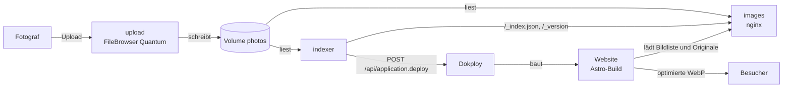

# Architektur

## Komponenten

| Komponente | Ort | Aufgabe |
| :--- | :--- | :--- |
| Website | Repository-Wurzel, `DOCKERFILE` | Astro-Seite, wird beim Build statisch erzeugt und über nginx ausgeliefert |
| `images` | `image-server/nginx/` | nginx, liefert die Fotos aus dem Volume `photos` aus und leitet `/_index.json` und `/_version` an den Indexer weiter |
| `upload` | `image-server/filebrowser/` | FileBrowser Quantum, Weboberfläche zum Hochladen und Verwalten der Fotos im Volume `photos` |
| `indexer` | `image-server/indexer/` | Durchsucht das Volume alle 30 Sekunden, stellt die Bildliste bereit und löst nach Änderungen einen Rebuild der Website in Dokploy aus |

Alle drei Dienste des Bildservers teilen sich das Docker-Volume `photos`. `upload` schreibt hinein, `images` und `indexer` lesen nur (`:ro`).

## Datenfluss



1. Fotos werden über `upload.mathisheck.de` in Ordner wie `street/` hochgeladen.
2. Der Indexer bemerkt die Änderung beim nächsten Scan.
3. Gibt es danach `QUIET_SECONDS` lang (Standard 120) keine weitere Änderung, ruft der Indexer die Dokploy-API auf und startet den Rebuild der Website.
4. Beim Build liest Astro `https://images.mathisheck.de/_index.json`, lädt die Originale und erzeugt optimierte Bilder in `dist/_astro/`.
5. Die fertige Website enthält nur noch die optimierten Bilder.

## Bildliste und Version

Der Indexer (`image-server/indexer/indexer.mjs`) betrachtet jeden Ordner direkt unter dem Volume als Serie oder Cover-Ordner. Er berücksichtigt nur Dateien mit den Endungen `.jpg`, `.jpeg`, `.png`, `.webp`, `.avif`. Versteckte Dateien und Ordner (Name beginnt mit `.`) und Unterordner in Serienordnern werden ignoriert.

**`GET /_index.json`**

```json
{
  "version": "541f168aed90cca8",
  "folders": {
    "street": ["mathisheck-11_oqepsf.jpg", "..."],
    "cover": ["astro.jpg", "blackandwhite.jpg", "..."]
  }
}
```

Die Dateinamen sind pro Ordner nach Namen sortiert. Bis der erste Scan nach dem Start abgeschlossen ist, antwortet der Indexer mit HTTP 503.

**`GET /_version`**

Ein Hash (16 Zeichen) über Pfad, Größe und Änderungszeit aller Fotos. Er ändert sich, sobald ein Foto hinzugefügt, gelöscht oder ersetzt wird.

Beide Antworten werden von nginx mit `Cache-Control: no-store` ausgeliefert. Fotos selbst mit `Cache-Control: public, max-age=300`. Dateien und Ordner, deren Name mit `.` beginnt, liefert nginx nicht aus (403), Verzeichnislisten sind abgeschaltet.

## Build-Cache

Docker verwendet Build-Schritte aus dem Cache, wenn sich die kopierten Dateien nicht geändert haben. Ohne Gegenmaßnahme würde ein Rebuild nach einem Upload die alte Seite aus dem Cache liefern, weil sich am Code nichts geändert hat.

Deshalb lädt das `DOCKERFILE` vor dem Build die Version herunter:

```dockerfile
ADD ${PUBLIC_IMAGE_BASE_URL}/_version /tmp/images-version
RUN npm run build
```

Ändert sich der Inhalt von `/_version`, ist der Cache ab dieser Zeile ungültig und `npm run build` läuft neu. Ohne Fotoänderung bleibt der Build vollständig im Cache.

## Warum die Bilder beim Build optimiert werden

- Besucher laden kleine WebP-Dateien in passenden Größen (`srcset`) statt mehrere Megabyte große Originale.
- Die Website funktioniert auch, wenn der Bildserver kurz nicht erreichbar ist, denn die Bilder liegen fertig in `dist/`.
- Der Bildserver muss nur für den Build erreichbar sein, nicht für jeden Seitenaufruf.

Nachteil: Neue Fotos erscheinen erst nach einem Rebuild. Den löst der Indexer automatisch aus.

## Bildquelle im Code

`src/lib/images.ts` entscheidet anhand von `PUBLIC_IMAGE_BASE_URL`:

| `PUBLIC_IMAGE_BASE_URL` | Bildliste | Bilder |
| :--- | :--- | :--- |
| gesetzt | `<base>/_index.json` (einmal pro Build geladen) | `<base>/<ordner>/<datei>` |
| nicht gesetzt | Dateien in `src/assets/<ordner>/` | `src/assets/<ordner>/<datei>` |

`astro.config.mjs` erlaubt Astro, Bilder vom Host aus `PUBLIC_IMAGE_BASE_URL` zu laden (`image.remotePatterns`).

## Aufbau des Repositorys

```text
.
├── DOCKERFILE                       Build der Website (Node) und Auslieferung (nginx)
├── .dockerignore                    Vom Docker-Build ausgeschlossene Dateien
├── .env.example                     Vorlage für PUBLIC_IMAGE_BASE_URL
├── astro.config.mjs                 Astro-Konfiguration, Tailwind, erlaubter Bild-Host
├── package.json                     Abhängigkeiten und npm-Skripte
├── public/                          Statische Dateien (favicon.svg, bio.png)
├── src/
│   ├── assets/                      Optional: lokale Fotos (nicht im Repository)
│   ├── components/SiteHeader.astro  Kopfzeile mit Navigation und Mobilmenü
│   ├── data/series.json             Serien: Titel, Beschreibung, Ordner, Cover
│   ├── layouts/BaseLayout.astro     Grundgerüst jeder Seite, Schriften, Meta-Tags
│   ├── lib/images.ts                Bildliste und Bildpfade (Bildserver oder lokal)
│   ├── pages/index.astro            Startseite
│   ├── pages/images.astro           Übersicht aller Serien
│   ├── pages/images/[slug].astro    Galerie einer Serie mit Lightbox
│   ├── pages/contact.astro          Kontakt
│   ├── pages/impressum.astro        Impressum
│   └── styles/global.css            Globales Styling
├── image-server/
│   ├── docker-compose.yml           Bildserver für Dokploy (images, upload, indexer)
│   ├── nginx/Dockerfile             nginx-Image für images
│   ├── nginx/default.conf           Auslieferung der Fotos, Weiterleitung an den Indexer
│   ├── filebrowser/Dockerfile       FileBrowser-Quantum-Image mit eingebauter Konfiguration
│   ├── filebrowser/config.yaml      Upload-Ordner, Rechte, Login-Einstellungen
│   ├── indexer/Dockerfile           Node-Image für den Indexer
│   └── indexer/indexer.mjs          Scan, /_index.json, /_version, Dokploy-Rebuild
└── docs/                            Diese Dokumentation
```
